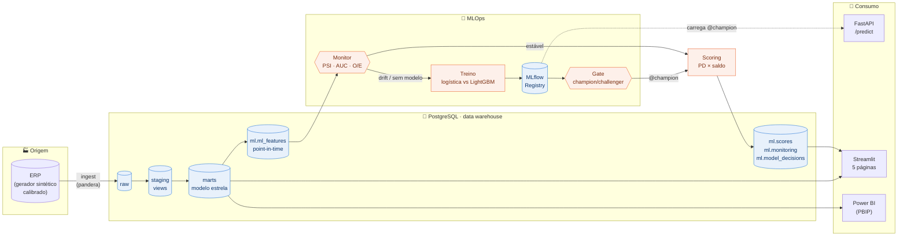
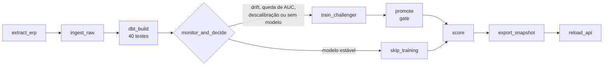
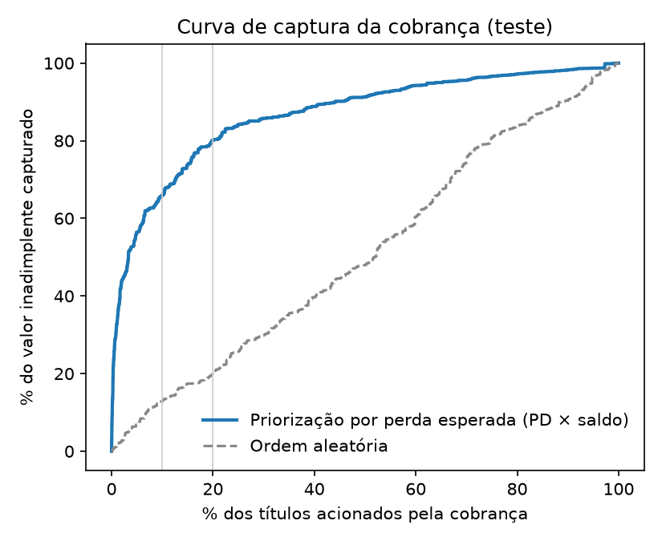
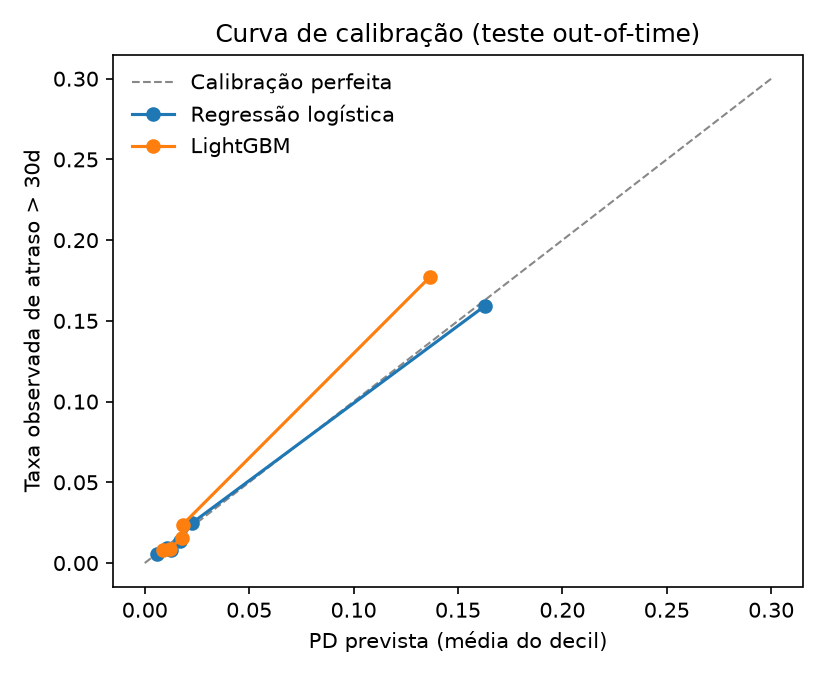
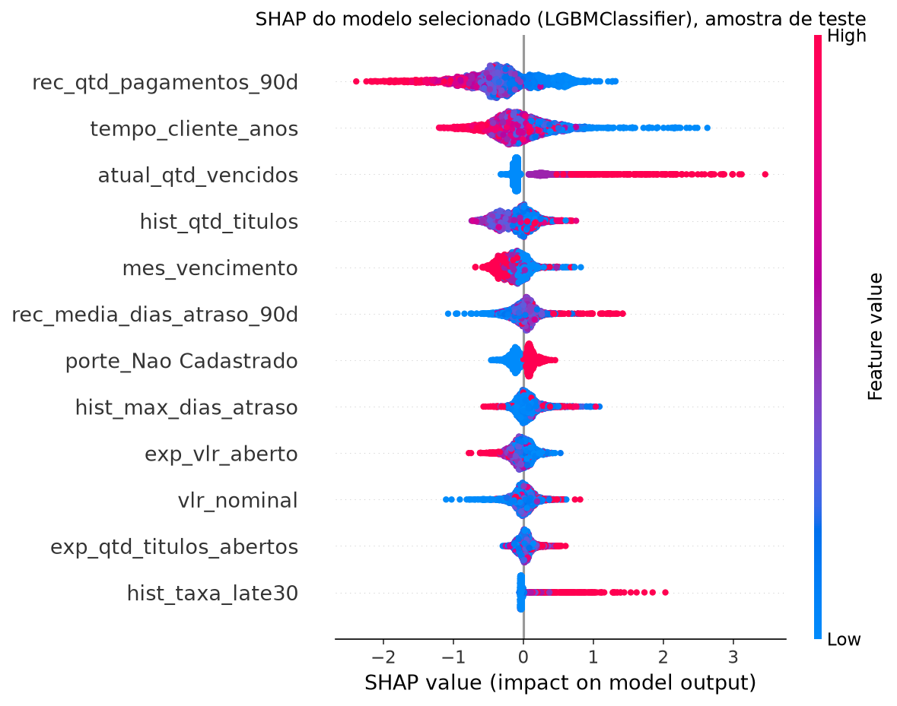
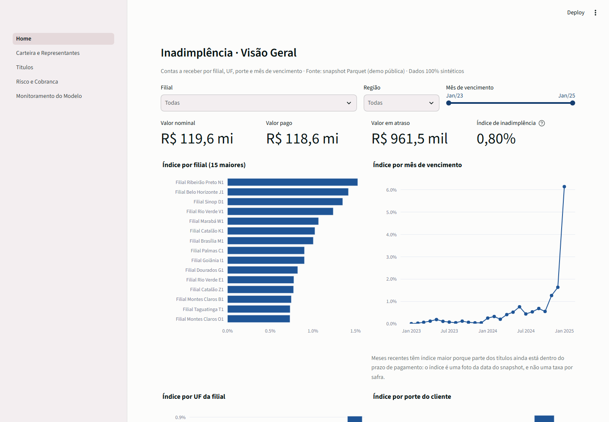
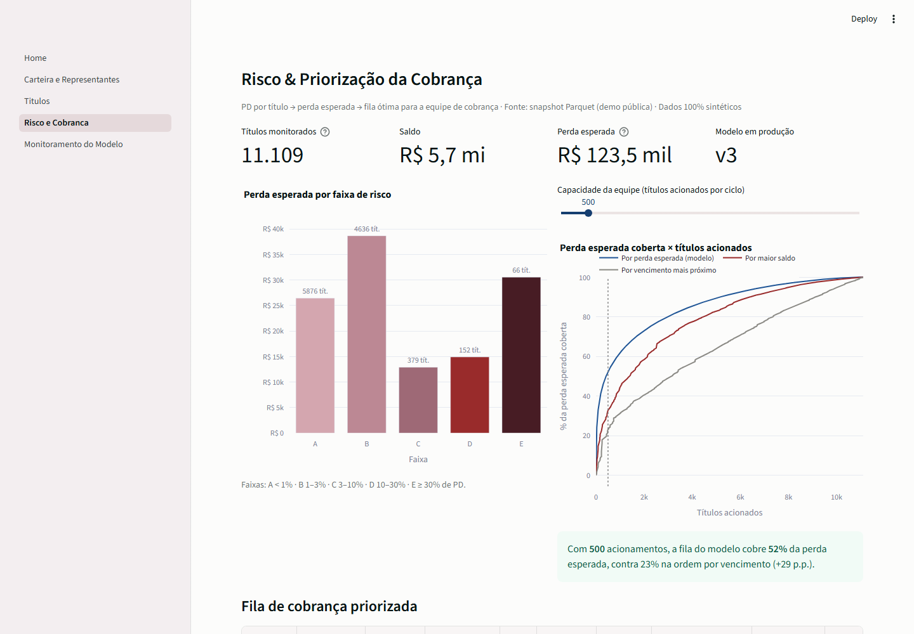
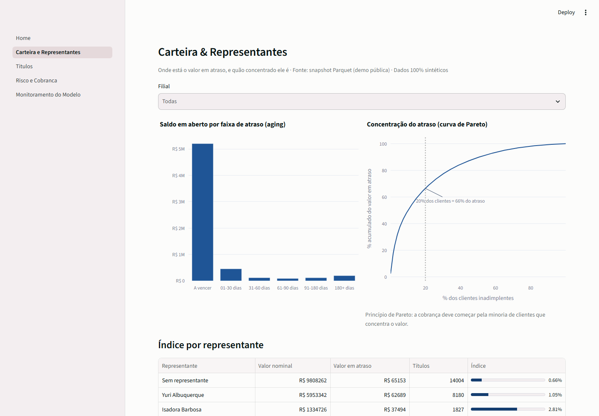
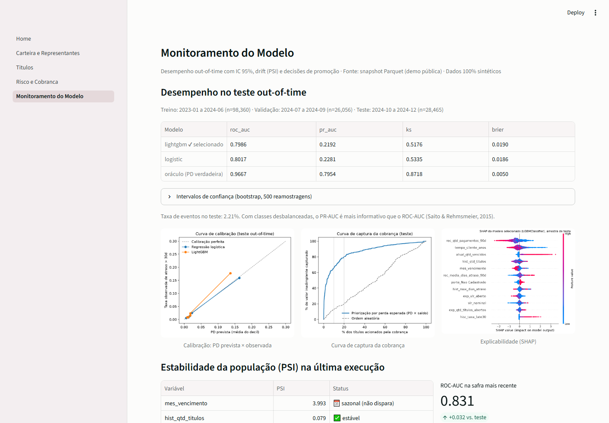

<div align="center">

# 📉 Credit Risk & Collections

### Risco de crédito e priorização de cobrança de ponta a ponta: do ERP ao modelo em produção monitorado

*Um dashboard de inadimplência em Power BI, reconstruído como produto de dados completo: engenharia de dados, modelagem estatística, MLOps e visualização.*


<br>


<br>


[**▶ Demo**](#-demo) · [Arquitetura](#-arquitetura) · [Método científico](#-método-problema--hipótese--método--evidência--decisão) · [Resultados](#-resultados) · [MLOps](#-mlops-o-modelo-se-mantém-sozinho) · [Como rodar](#-como-rodar)

</div>

---

## 🎯 O problema de negócio

Uma distribuidora atacadista vende a prazo para milhares de lojistas. Todo mês, uma fração das duplicatas atrasa mais de 30 dias, e **a equipe de cobrança não consegue ligar para todos**. O relatório original em Power BI mostrava **o que já tinha atrasado** (índice de inadimplência por filial, UF e representante), mas não respondia à pergunta que gera caixa:

> **Quais títulos, que ainda não atrasaram, devem ser cobrados primeiro?**

Este projeto reconstrói o relatório e acrescenta essa resposta: um modelo de **probabilidade de inadimplência (PD)** que alimenta uma **fila de cobrança priorizada por perda esperada**, mantido em produção por um pipeline que **monitora e retreina o próprio modelo**.

| | Antes (Power BI original) | Depois (este projeto) |
|---|---|---|
| Pergunta | "Quanto já atrasou?" (retrovisor) | "Quem vai atrasar e onde agir primeiro?" (para-brisa) |
| Regras de negócio | Espalhadas em SQL do Power Query + DAX | SQL versionado no dbt, com **40 testes de dados** |
| Atualização | Manual, depende de `getdate()` | Orquestrada (Airflow) e **reprodutível** (data de snapshot) |
| Inteligência | Nenhuma | PD calibrada, explicável (SHAP), com IC 95% |
| Manutenção | — | Monitoramento de drift + retreino condicional + gate de promoção |

> 🔒 **Privacidade:** o projeto parte de um relatório real de uma empresa, porém **nenhum dado real está neste repositório**: os dados são 100% sintéticos, com IDs aleatórios, nomes fictícios, produtos apenas por código e geografia e calendário próprios (ver [data card](docs/data_card.md)). A empresa "Distribuidora" é fictícia.

---

## 🏗 Arquitetura



Tudo sobe com **um comando** (`docker compose up`): 5 serviços com healthchecks, um único PostgreSQL com três bancos isolados (warehouse, metadados do Airflow e backend do MLflow) e um usuário **somente leitura** para as ferramentas de BI (menor privilégio).

<details>
<summary><b>🔀 A DAG do Airflow (clique para expandir)</b></summary>



O retreino **não roda por calendário**: roda quando a evidência indica que o modelo precisa ser atualizado.
</details>

---

## 🔬 Método: Problema → Hipótese → Método → Evidência → Decisão

| Etapa | Neste projeto |
|---|---|
| **Problema** | Priorizar a cobrança preventiva com capacidade limitada da equipe |
| **Hipótese** | O comportamento recente de pagamento do cliente prediz atraso > 30 dias melhor do que o perfil cadastral |
| **Método** | Separação **temporal** (train < valid < test), baseline interpretável vs. boosting, **teste pareado de superioridade**, calibração isotônica, IC 95% por bootstrap, comparação com o **oráculo** (PD verdadeira do gerador) |
| **Evidência** | Ver [Resultados](#-resultados): a feature mais importante é a quantidade de títulos vencidos em aberto na data da emissão |
| **Decisão** | LightGBM calibrado, escolhido por um **teste pareado de superioridade** na validação (com a regressão logística como alternativa sempre que não houver ganho significativo), e fila ordenada por **perda esperada = PD × saldo** |

**Por que estes modelos?** A escolha foi embasada na literatura e na prática de competições. Benchmarks de credit scoring (Lessmann et al., 2015, *EJOR*; Gunnarsson et al., 2021, *EJOR*) e de dados tabulares (Grinsztajn et al., 2022, *NeurIPS*; McElfresh et al., 2023, *NeurIPS*) apontam o **gradient boosting** como estado da arte e a **regressão logística** como baseline obrigatório do setor. As soluções do Kaggle (Home Credit, AMEX) mostram que **features de comportamento importam mais que o algoritmo**. 👉 Detalhes, links e o protocolo de decisão em [**docs/model_selection.md**](docs/model_selection.md).

<details>
<summary><b>🛡 Cuidados contra vazamento de informação (leakage)</b></summary>

| Armadilha | Como foi evitada |
|---|---|
| Histórico do cliente "vendo o futuro" | Features **point-in-time** no dbt: só títulos com rótulo conhecido na data de emissão (`vencimento + 31 ≤ emissão`); dias de atraso truncados na emissão |
| Tipo `TERC` (cobrança terceirizada) | Só existe **depois** do calote. O modelo usa o `tipo_origem` |
| Rotular como "bom" o que ainda não maturou | `label_disponivel` = 31 dias após o vencimento |
| Avaliação otimista com split aleatório | Split **out-of-time**; o teste é usado uma única vez |
| Regressão do teste | Teste singular `assert_no_label_leakage` roda em **todo** `dbt build` |
</details>

---

## 📊 Resultados

Teste **out-of-time** (vencimentos de out–dez/2024, 28.465 títulos, 2,21% de eventos), com **IC 95% por bootstrap**:

| Modelo | ROC-AUC | PR-AUC | KS | Brier |
|---|---|---|---|---|
| Regressão logística (baseline) | 0,802 [0,780; 0,824] | 0,228 [0,198; 0,257] | 0,534 | 0,0186 |
| **LightGBM calibrado** (em produção) | 0,799 [0,778; 0,817] | 0,219 [0,190; 0,252] | 0,518 | 0,0190 |
| *Oráculo: PD verdadeira (limite teórico)* | *0,967* | *0,795* | *0,872* | *0,0050* |
| *Classificador aleatório* | *0,500* | *0,022* | *0* | — |

**Leitura dos resultados:**
1. **O modelo discrimina bem**: PR-AUC de 0,22 é cerca de **10× a taxa-base** de 2,2%, e o KS > 0,5 é considerado forte em crédito (Siddiqi, 2017).
2. **Features importam mais que algoritmo.** A primeira versão (só histórico de rótulos maturados) tinha ROC-AUC de 0,72. Os sinais **tempestivos** na data de emissão (títulos vencidos em aberto, pagamentos dos últimos 90 dias) levaram a 0,80. Trocar de algoritmo não mudou o resultado.
3. **Seleção sem p-hacking.** O LightGBM foi significativamente melhor na **validação** (ΔPR-AUC = +0,063, IC 95% pareado [+0,033; +0,089]) e por isso foi escolhido. No **teste**, empatou com a logística (ICs sobrepostos). A regra foi definida *antes* de olhar o teste, então o resultado é reportado como está: a vantagem do boosting não se generalizou para o trimestre seguinte, o que reforça a importância do monitoramento por safra.
4. **A distância até o oráculo é um limite do problema**: o regime de dificuldade do cliente *no mês do vencimento* não é observável na emissão.

<table>
<tr>
<td width="33%"><br><sub><b>Curva de captura:</b> acionando 20% dos títulos, a cobrança alcança <b>80% do valor inadimplente</b> (contra cerca de 20% em ordem aleatória). O princípio de Pareto aplicado à operação.</sub></td>
<td width="33%"><br><sub><b>Calibração:</b> a PD prevista acompanha a taxa observada. Requisito para usar a PD em cálculo financeiro (perda esperada).</sub></td>
<td width="33%"><br><sub><b>SHAP:</b> comportamento recente de pagamento e títulos vencidos em aberto dominam a previsão, confirmando a hipótese.</sub></td>
</tr>
</table>

---

## ♻ MLOps: o modelo se mantém sozinho

Experimento real com o pipeline: três execuções seguidas, a do meio com uma **crise simulada** (out/2024: ticket +25% e mais clientes em dificuldade).

| Execução | O monitoramento viu | Decisão automática |
|---|---|---|
| 1. Base | Nenhum modelo em produção | Treina v1 → gate ✅ → **v1 champion** (ROC-AUC 0,797) |
| 2. **Crise** | **Observado/esperado = 2,43** (inadimplência 2,4× acima do previsto) e **ROC-AUC 0,797 → 0,705** na safra recente | Retreina v2 → gate compara **na mesma janela**: v2 PR-AUC 0,187 vs. v1 0,170 → **v2 promovido** |
| 3. Normalização | O/E = 1,15 e ROC-AUC 0,814: **estável** | Não precisaria retreinar (retreino forçado só para gerar o estado final) |

**Lições do experimento**:
- **O PSI não basta.** Na crise, o PSI do score ficou em 0,003, ou seja, a *população* não mudou, mas o *comportamento* mudou. Só a **calibração (O/E)** e o **AUC por safra** detectaram a ruptura. Por isso o monitor usa **três sinais complementares**.
- **Variáveis de calendário geram falso alarme** (PSI de 3,9 em `mes_vencimento` entre janelas diferentes). Elas são reportadas, mas não disparam retreino.
- **O gate protege a produção**: em uma execução anterior, um challenger treinado logo após o choque ficou abaixo do piso (ROC-AUC 0,668 < 0,70) e **não foi promovido**. A decisão ficou registrada em `ml.model_decisions`.
- **Cada modelo carrega o próprio contrato de entrada** (`feature_names_in_`): champion e challenger com features diferentes convivem sem quebrar a API.
- **Serialização segura** (skops) com allowlist explícita de tipos, em vez de pickle.

---

## 🖥 Demo

| Visão geral | Risco e priorização da cobrança |
|---|---|
|  |  |
| **Carteira e concentração (Pareto)** | **Monitoramento do modelo** |
|  |  |

O app tem 5 páginas: visão geral, carteira e representantes, títulos (analítico com exportação CSV), risco e cobrança (com **simulador de capacidade da equipe** e chamada ao vivo da API) e monitoramento do modelo.

---

## 🚀 Como rodar

**Pré-requisitos:** Docker Desktop (8 GB de RAM recomendados).

```bash
git clone https://github.com/mathewsca/credit-risk-collections.git
cd credit-risk-collections
docker compose up -d --build          # sobe Postgres, MLflow, Airflow, API e Streamlit
docker compose exec airflow airflow dags trigger credit_risk_pipeline   # roda o pipeline (~8 min)
```

| Serviço | URL |
|---|---|
| Streamlit (dashboard) | http://localhost:8501 |
| Airflow (orquestração) | http://localhost:8080 |
| MLflow (experimentos e registry) | http://localhost:5000 |
| FastAPI (docs interativas) | http://localhost:8000/docs |
| PostgreSQL | `localhost:5432` · db `warehouse` · usuário BI `bi_reader` |

**Simular uma crise e ver o MLOps reagir:**
```bash
docker compose exec airflow airflow dags trigger credit_risk_pipeline -c '{"scenario": "shock"}'
```

<details>
<summary><b>Desenvolvimento local (sem Docker)</b></summary>

```bash
python -m venv .venv && source .venv/bin/activate   # Windows: .venv\Scripts\activate
pip install -e ".[api,app,dbt,dev]"
pytest                       # testes unitários
ruff check . && ruff format --check .
streamlit run app/Home.py    # lê o snapshot Parquet em app/data
```
</details>

---

## 📁 Estrutura

```
├── config/generator.yaml        # parâmetros do gerador (mecanismo causal documentado)
├── src/credit_risk/
│   ├── generator/               # dados sintéticos do ERP
│   ├── ingest.py                # landing -> raw (COPY + contrato pandera)
│   ├── ml/                      # features, train, promote, score, monitor, metrics, registry
│   └── export.py                # snapshot Parquet para o app público
├── dbt/                         # staging -> marts -> ml_features (+ testes e anti-leakage)
├── pipelines/dags/              # DAG do Airflow 3
├── api/                         # FastAPI
├── app/                         # Streamlit (5 páginas)
├── powerbi/                     # modelo semântico PBIP (TMDL)
├── docker/ · docker-compose.yml # infraestrutura
├── docs/                        # model card, data card, seleção de modelos, DAX→SQL, referências
└── tests/                       # pytest
```

## 📚 Documentação

- [Seleção de modelos: evidências e protocolo](docs/model_selection.md)
- [Model card](docs/model_card.md) · [Data card](docs/data_card.md)
- [Migração DAX/Power Query → dbt](docs/dax_to_sql.md)
- [Referências científicas](docs/references.md)

---

